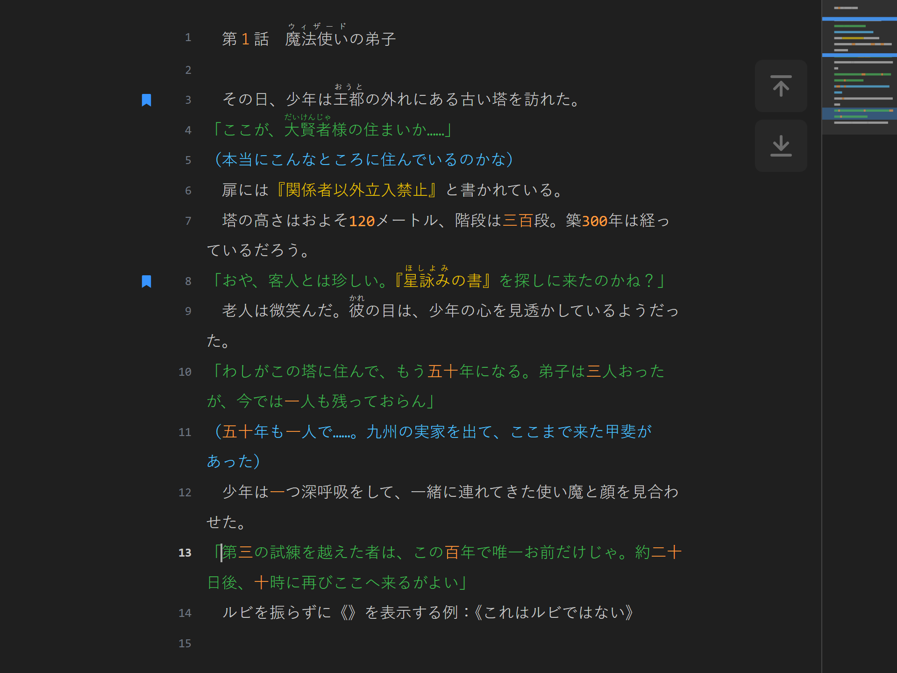
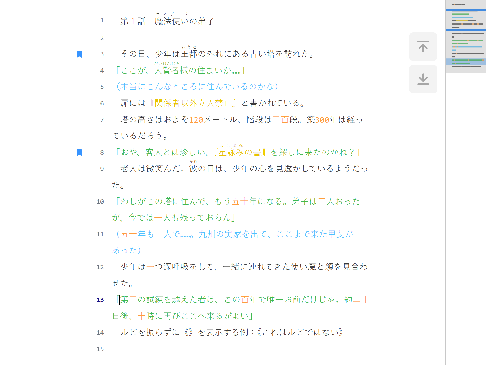
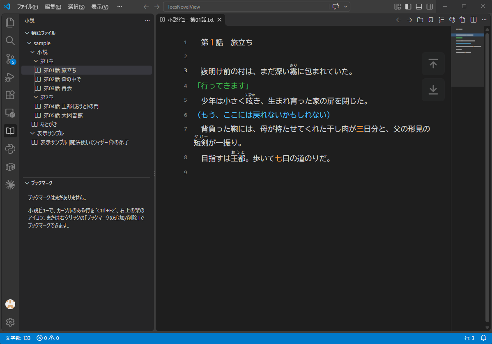
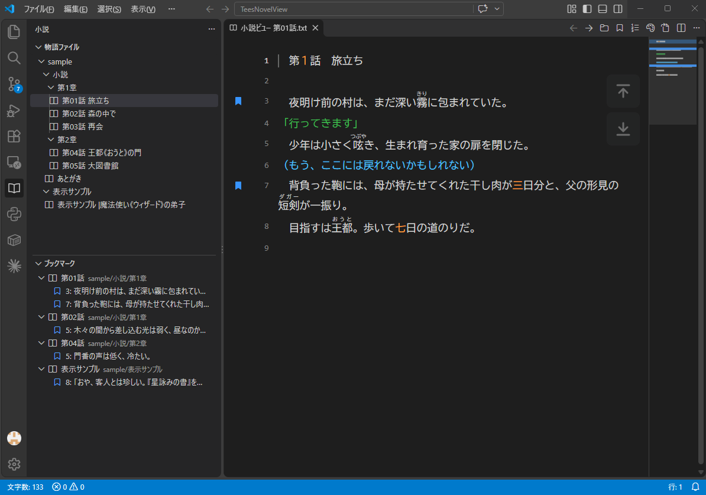

# Tee's Novel View

## 概要

`.txt` ファイルを小説として閲覧するための、閲覧専用の「小説ビュー」を追加する VS Code 拡張機能です。

作者が自分の作品の投稿を管理するために作ったものです。そのため、「小説家になろう」の形式に合わせた機能（ルビ表記、投稿済みエピソードの編集ページを開く機能など）が中心になっています。



- 「小説家になろう」形式のルビ表記を、実際のルビとして表示
- 会話文「」・心の声（）・『』内・数字（漢数字を含む）の色分け、正規表現による任意のカラーリング（個別に ON/OFF 可）
- 1行あたりの表示文字数、行番号、カーソルと範囲選択、ミニマップ
- 物語ファイル一覧（アクティビティバー。ファイルごとの文字数も表示）と前話・次話への移動
- 「小説家になろう」の編集ページを開く「編集投稿」（URL はエピソード一覧のソースから一括設定）
- ブックマーク（名前付き・一覧から移動・`F2` で移動）
- Git の変更の表示（変更行の印、変更前後を並べた比較画面）
- ステータスバーに文字数（ルビ・改行・空白を除く）とカーソル行を表示
- 文字色・背景色は VS Code のテーマに追従

## インストール

VS Code の拡張機能ビュー（`Ctrl+Shift+X`）で「Tee's Novel View」を検索してインストールするか、次のコマンドを実行します。

```bash
code --install-extension Tees-software.tees-novel-view
```

動作環境: VS Code 1.75 以降

## 機能一覧

ショートカットは Windows / Linux の表記です。Mac では `Ctrl` を `Cmd` に読み替えてください。各機能の名前から、詳しい説明に移動できます。

| 機能 | できること | 主な操作 |
| --- | --- | --- |
| [小説ビュー](#小説ビュー) | `.txt` を小説として表示（1行の文字数、行番号、テーマに追従した配色） | `Ctrl+Shift+V` / エディター右上の本のアイコン / エクスプローラー・タブの右クリック |
| [ソースとの切り替え](#ソースとの切り替え) | 元のテキストと同じ場所で切り替え、または横に並べて表示 | `Ctrl+Shift+V` / 小説ビュー右上のアイコン / `Ctrl+K V`（横に開く） |
| [カーソルと選択](#カーソルと選択) | 閲覧専用のカーソル、範囲選択とコピー | クリック / 矢印キー / `Ctrl+A` `Ctrl+C` |
| [コピー](#コピー) | タイトル・本文を、ルビ記法を含む元のテキストのままコピー | 小説ビューの右クリック |
| [スクロールボタンとミニマップ](#スクロールボタンとミニマップ) | 一番上・一番下への移動、文章全体の縮小表示 | 小説ビュー右上のボタン / 右端のミニマップ |
| [カラーリング](#カラーリング) | 会話文・心の声・『』・数字の色分け、正規表現による色分け | 小説ビュー右上のアイコン（ON/OFF） |
| [ルビ表示](#ルビ表示) | 「小説家になろう」形式のルビを表示 | コマンド「Novel View: ルビ表示の ON/OFF を切り替え」 |
| [前話と次話](#前話と次話) | ファイル名の番号や一覧の並び順で、前後の話を開く | 小説ビュー右上の ← → アイコン |
| [物語ファイル一覧](#物語ファイル一覧) | 物語ファイルを番号順・タイトル・文字数付きで一覧表示。複数選択で合計文字数 | アクティビティバーの本のアイコン |
| [編集投稿](#編集投稿) | 「小説家になろう」の編集ページを外部ブラウザで開く | 小説ビュー左上のボタン / 物語ファイル一覧のアイコン・右クリック |
| [ブックマーク](#ブックマーク) | 行に名前付きの栞を付け、一覧や `F2` で移動 | `Ctrl+F2` / `F2` / `Shift+F2` / ブックマーク一覧 |
| [Git の変更](#git-の変更) | 変更行の印、変更前後を並べた比較画面 | 小説ビュー右上・物語ファイル一覧の「変更を開く」アイコン |
| [ステータスバー](#ステータスバー) | 文字数（ルビ・改行・空白を除く）とカーソル行、複数選択した物語の合計文字数を表示 | 小説ビュー・`.txt` を開いているとき自動で表示 / 物語ファイル一覧で複数選択 |

## 機能詳細

### 小説ビュー

`.txt` ファイルを、ルビと色分けを付けた読みやすい形で表示します。閲覧専用なので、表示中に誤って本文を書き換えることはありません。

| 操作 | 方法 |
| --- | --- |
| 小説ビューで開く | `Ctrl+Shift+V` / エディター右上の本のアイコン / エクスプローラー・タブの右クリック |
| 行番号の表示 ON/OFF | 小説ビュー右上のアイコン / コマンド「Novel View: 行番号の表示を切り替え」 |

- 1行あたりの文字数（全角換算）、フォント、文字サイズ、行の高さは設定で変えられます（[小説ビューの設定](#小説ビューの設定)）
- 行番号は、元のテキストの行番号です
- 文字色・背景色は VS Code のテーマに追従します。ライトテーマでは次のように表示されます



### ソースとの切り替え

| 操作 | 方法 |
| --- | --- |
| ソースに切り替え | `Ctrl+Shift+V` / 小説ビュー右上のアイコン / 小説ビューの右クリック |
| 小説ビューを横に開く | `Ctrl+K V` / タブの右クリック |

- 小説ビューとソースは同じ場所で切り替わり、読んでいた位置とカーソル・選択範囲が引き継がれます（未保存の変更がある場合、ソースのタブは閉じずに残ります）
- 横に開いた場合は、編集内容が小説ビューにリアルタイムで反映され、エディターのスクロールにも追従します（設定 `teesNovelView.scrollSync`）
- 別のアプリでの編集や Git の操作でファイルが変わった場合も、小説ビューは自動で描き直されます（ソースのタブを開いていなくても反映されます）

### カーソルと選択

小説ビューは閲覧専用ですが、クリックした位置にカーソルが表示されます。

- `←` `→` `↑` `↓` で移動、`Shift` を押しながらで範囲選択
- `Home` / `End` で表示上の行頭・行末、`Ctrl+Home` / `Ctrl+End` で先頭・末尾
- `Ctrl+A` で全文選択、`Ctrl+C` でコピー（ルビの読みは含まれません）

### コピー

小説ビューの右クリックメニューから、元のテキストをそのままコピーできます。投稿フォームへの貼り付けなどに使えます。

| 操作 | 内容 |
| --- | --- |
| タイトルをコピー | 元のテキストの 1 行目を、ルビ記法や字下げも書かれたまま、改行なしでコピー |
| 本文をコピー | 元のテキストの先頭2行を除いた全文を、ルビ記法を含めてコピー（除く行数は設定 `teesNovelView.copyBody.skipLines`） |

### スクロールボタンとミニマップ

| 表示 | 内容 |
| --- | --- |
| 一番上・一番下へスクロール | 小説ビューの表示領域の右上のボタン |
| ミニマップ | 小説ビューの右端。文章全体の縮小表示（色分け・ブックマーク・カーソル行を含む）。クリックでその位置へ移動、表示範囲の枠をドラッグでスクロール |

ミニマップの表示と幅は設定で変えられます（[小説ビューの設定](#小説ビューの設定)）。

### カラーリング

会話文「」・心の声（）・『』内・数字（漢数字を含む）を色分けします。正規表現で任意の文字列に色を付けることもできます。

| 操作 | 方法 |
| --- | --- |
| カラーリング ON/OFF | 小説ビュー右上のアイコン / コマンド「Novel View: カラーリングの ON/OFF を切り替え」 |

- 各グループは個別に ON/OFF と色を変えられます。括弧のグループは、対象の括弧も変えられます（[カラーリングの設定](#カラーリングの設定)）
- 漢数字は前後の文字で「数として使われているか」を判定します。直前が漢字（接頭語を除く）、または直後が助数詞以外の漢字の場合は熟語の一部とみなして色を付けません（例: 三人・二十一歳・第三話・一つ → 色付け / 統一・一緒・九州・八百屋 → 色なし）
- 優先順位は **正規表現ルール > 数字 > 括弧**（括弧が入れ子の場合は内側が優先）です

### ルビ表示

「小説家になろう」形式のルビ表記を、実際のルビとして表示します。

| 操作 | 方法 |
| --- | --- |
| ルビ表示 ON/OFF | コマンド「Novel View: ルビ表示の ON/OFF を切り替え」（設定 `teesNovelView.ruby.enabled`） |

#### ルビの書き方

| 書き方 | 表示 |
| --- | --- |
| `\|魔法使い《ウィザード》` `｜魔法使い《ウィザード》` | 縦棒から《までの文字にルビ（ひらがな等にも可） |
| `王都《おうと》` | 《の直前の連続した漢字にルビ |
| `王都(おうと)` `王都（おうと）` | 既定ではルビにせず、通常の括弧書きとして表示。設定 `teesNovelView.ruby.parentheses` を ON にすると、括弧内がひらがな・カタカナのみの場合に限りルビ（「小説家になろう」と同じ） |
| `\|《これはルビではない》` | ルビにせず《》をそのまま表示 |

親文字は20文字、ルビは10文字まで。これを超える場合はルビにせずそのまま表示します。

#### 対応していない書き方

次の書き方はルビ（や傍点などの装飾）として扱わず、書かれた文字をそのまま表示します。

| 書き方 | 表示 | 代わりの書き方 |
| --- | --- | --- |
| `カタカナ《かたかな》` `ひらがな《ルビ》` `ABC《エービーシー》` | 縦棒が無い場合、ルビになるのは直前の**漢字**だけです。漢字以外はそのまま表示します | `\|カタカナ《かたかな》` のように縦棒を付ける |
| `《《傍点》》`（カクヨム形式の傍点） | そのまま表示 | `\|傍点《・・》` のようにルビとして「・」を振る |
| `［＃傍点］…［＃傍点終わり］` などの青空文庫形式の注記 | そのまま表示 | ― |
| `<ruby>漢字<rt>かんじ</rt></ruby>` などの HTML タグ | そのまま表示（タグも文字として表示） | `\|漢字《かんじ》` |
| `<i123456\|7890>`（小説家になろうの挿絵） | そのまま表示 | ― |
| 改行をまたぐルビ（`漢字《かん` で改行して `じ》`） | そのまま表示（ルビは 1 行の中で完結している必要があります） | 1 行にまとめる |
| ルビの中に縦棒がある（`\|漢字《か\|ん》`） | そのまま表示 | ルビの中に `\|` を入れない |
| 空のルビ（`漢字《》`） | そのまま表示 | ― |
| 親文字が21文字以上、またはルビが11文字以上 | そのまま表示 | 親文字を分けて、複数のルビにする |

### 前話と次話

小説ビュー右上の ← → アイコンで、ファイル名の番号（既定では最後の数字。半角・全角どちらも可）を前後させたファイルを、同じタブで開きます。

- 同じフォルダーの `.txt` のうち、**番号より前の部分が同じ**ファイルが対象です（`第01話_旅立ち.txt` → `第02話_森の中で.txt` のように、番号の後ろのタイトルは違っていても構いません）
- 番号が飛んでいる場合は、その方向で最も近い番号のファイルを開きます
- 前後の話が無い場合、アイコンは押せない状態になります
- 前話・次話のアイコンの右のボタンで、移動の仕方を切り替えられます（設定 `teesNovelView.episode.followStoryList`）
  - フォルダーのアイコン（既定）: 同じフォルダーの中から、ファイル名の番号で前後を探します
  - ツリーのアイコン: 物語ファイル一覧の並び順で前後へ移動します。章ごとのフォルダー（`第1章/第03話` → `第2章/第04話`）や、`あとがき` のように番号の付け方が違うファイルもまたいで移動できます。表示中のファイルが一覧に無い場合は、ファイル名の番号で探します
- 番号の取り出し方は `teesNovelView.episode.numberPattern`（正規表現）で変更できます。キャプチャグループがあれば1番目のグループを番号とみなします（例: `第([0-9０-９]+)話`）

### 物語ファイル一覧

左端のアクティビティバーの本のアイコンから、物語ファイルの一覧を表示できます。



- ファイルを選択すると、エディターで表示中の小説ビューがあればそこに置き換えて表示し、無ければ新しい小説ビューで開きます
- 一覧の右上のボタンで、クリックしたときの開き方を切り替えられます（本のアイコン: 小説ビューで開く / テキストファイルのアイコン: 元のテキストファイルをエディターで開く。設定 `teesNovelView.stories.openInNovelView`）
- 一覧はフォルダーごとのツリーで、番号順（第2話 → 第10話）に並びます
- ファイルの先頭が「第〇話　タイトル」の形式なら、ファイル名の右にタイトル（話数を除いた部分。ルビ記法はそのまま）を表示します（例: `第01話 旅立ち`）
- ファイル名とタイトルの間に、ファイルごとの文字数（ステータスバーと同じく、ルビ・改行・空白を除く）を表示します（例: `第01話 (3,456) 旅立ち`）。保存したファイルの内容で数えます。一覧の右上のボタンで表示・非表示を切り替えられます（設定 `teesNovelView.stories.showCharCount`）
- 表示中の小説ビューのファイルは、一覧で選択状態になります（複数選択中は選択を変えません）
- `Ctrl+クリック` / `Shift+クリック` で複数選択すると、選択したファイルの文字数の合計をステータスバーに表示します（[ステータスバー](#ステータスバー)）。フォルダーを選ぶと、その中のファイルすべてを合計します
- エクスプローラーと同じく、Git の状態（変更あり・未追跡など）に応じて色と記号が付きます
- Git の変更があるファイルは、マウスを乗せると右側に「変更を開く」アイコンが出ます（右クリックでも可）。変更前後を並べた比較画面を開きます
- ファイルの追加・削除・保存に合わせて自動で更新されます（右上のボタンで手動の再読み込みも可能）

**物語ファイルの自動検知**: 探すフォルダー内の `.txt` のうち、次のいずれかに当てはまるものを物語ファイルとみなします（UTF-8 / Shift_JIS）。

- ルビ `《》` がある
- 会話文 `「」` `『』` や心の声（行頭の `（…）`）が 2 つ以上ある
- 全角スペースで字下げした行が 3 行以上ある

さらに、物語ファイルは他のファイルと分けて 1 か所にまとめられている前提で、**物語ファイルが見つかったフォルダーの `.txt` はすべて物語ファイル**として扱います（内容から判定できない短いファイルやメモも含まれます）。

- 親フォルダーの中身（サブフォルダーを含む）が `.txt` だけなら、親フォルダーも対象に広げます。`小説/第1章/`・`小説/第2章/` のように章ごとに分けていても、どこか 1 か所で見つかれば `小説/` 全体が対象になります
- `.ts` や `.md` など別の種類のファイルがある階層で止まるので、物語以外の場所には広がりません
- 対象フォルダーの下のサブフォルダーは、中身が `.txt` だけのものを対象にします

検知されない場合や、別の場所を参照したい場合は、[物語ファイル一覧の設定](#物語ファイル一覧の設定) で調整できます。

### 編集投稿

物語ファイルごとに「小説家になろう」の編集ページの URL を記録し、小説ビューや物語ファイル一覧からブラウザで開けます。URL はブックマークと同じくワークスペースごとに保存します（別の PC には引き継がれません）。

| 機能 | 操作 |
| --- | --- |
| 編集投稿 | 小説ビューの左上に固定表示されるボタン / 物語ファイル一覧でマウスを乗せると右側に出るアイコン / 物語ファイル一覧の右クリック。外部ブラウザで URL を開きます（URL を記録したファイルだけ表示） |
| 編集投稿URL設定 | 物語ファイル一覧の右クリック。現在の URL が入った入力欄が開きます（空にして確定すると削除） |
| 編集投稿URL一括設定 | 物語ファイル一覧の右上のアイコン |

物語ファイル一覧の右クリックメニューは、誤クリックを防ぐため 1 項目ごとに区切り線で区切っています。

**一括設定の手順**

1. 「小説家になろう」で作品の投稿済のエピソード一覧を開き、ブラウザの「ページのソースを表示」で HTML ソースを全部コピーします（画面の文字を選択してコピーしたものにはリンクが含まれません）
2. 物語ファイル一覧の右上の「編集投稿URL一括設定」を押します
3. 複数のフォルダーが候補になるときは、対象のフォルダーを選びます（一致する件数の多い順に並びます）
4. 設定・上書きする件数を確認して「設定する」を押します

- エピソードの番号（`ep.N`）とファイル名の番号を照合します。番号の読み取りは前話・次話と同じです（設定 `teesNovelView.episode.numberPattern`）
- 同じ番号のファイルが複数あるときは、番号より前の部分が最も多いもの（`メモ2.txt` と `第02話.txt` なら `第〜話` の並び）に設定します。絞れないときは設定しません。章ごとに番号を振り直している場合は、章のフォルダーごとに照合することになります
- 照合できなかったファイルの URL は変更しません。一覧が複数ページに分かれている場合は、ページごとに実行できます

### ブックマーク

小説ビューで、カーソルのある行をブックマークできます。



| 操作 | 方法 |
| --- | --- |
| ブックマークの追加/削除 | `Ctrl+F2` / 小説ビュー右上の栞のアイコン / 小説ビューの右クリック |
| ブックマークへ移動 | アクティビティバーの本のアイコン →「ブックマーク」一覧で選択 |
| 次・前のブックマークへ移動 | `F2` / `Shift+F2`（端まで来たら反対側へ） |
| ファイルをまたいだ移動の ON/OFF | ブックマーク一覧の右上のボタン（ON: 書類が重なったアイコン / OFF: 書類1枚のアイコン） |
| 名前の変更・削除 | 一覧の項目にマウスを乗せると出るボタン、または右クリック |
| すべて削除 | 一覧の右上のボタン（確認あり） |

- 名前はその行の冒頭の文章で自動的に付きます。一覧では行番号を名前の前に `12: その日、少年は王都の外れにある古い…` の形で表示します（行番号は編集に合わせて常に最新）。名前は一覧の「名前を変更」で変えられます。同じ行でもう一度操作すると削除します
- ブックマークした行は、行番号の左（行番号が非表示のときは行の左の余白）に青い栞のマークが表示されます。マークにマウスを乗せると名前が表示されます
- 一覧から選ぶと、表示中の小説ビューがあればそこに、無ければ新しい小説ビューでその行を開きます
- ソースを編集して行が増減しても、ブックマークは同じ文章についていきます。ファイル名の変更にも追従します
- ブックマークはワークスペース（開いているフォルダー）ごとに保存され、VS Code を閉じても残ります。保存先は VS Code の内部なので、フォルダーの中にファイルは作られません
- `F2` / `Shift+F2` は、既定では表示中のファイルの中だけで移動します。ファイルをまたぐ移動を ON にすると、一覧の並び順で次のファイルのブックマークへ進みます（設定 `teesNovelView.bookmarks.crossFile`）

### Git の変更

ファイルが Git で管理されている場合、テキストエディターと同じように変更の有無と変更箇所を表示します。VS Code 標準の Git 拡張機能を使うので、追加の設定は要りません。

| 表示・操作 | 内容 |
| --- | --- |
| 変更行の印 | 本文の左端に、追加された行は緑の線、変更された行は青の線、削除された位置は赤の三角形を表示します。ミニマップにも同じ色で表示します |
| 変更を開く（小説ビュー） | 表示中のファイルに変更があるときだけ、小説ビュー右上に比較のアイコンが出ます |
| 変更を開く（物語ファイル一覧） | 変更のあるファイル（`M` `U` などの記号が付いたもの）にマウスを乗せると、右側に比較のアイコンが出ます。右クリックメニューからも開けます |

- 「変更を開く」は、テキストエディターの「変更を開く」と同じ、変更前後を左右に並べた比較画面を開きます
- 比較の基準はテキストエディターの左端の印と同じで、ステージ済みの内容（ステージしていなければ最後のコミット）です。保存前の編集も反映されます
- コミットやステージをすると、印とアイコンは自動で更新されます
- 変更行の印が不要な場合は、設定 `teesNovelView.gitChanges.enabled` を OFF にします

### ステータスバー

| 位置 | 表示 | 表示される場面 |
| --- | --- | --- |
| 左 | `文字数: 12,345` | 小説ビュー、または `.txt` をエディターで開いているとき |
| 左（文字数の右） | `合計: 123,456（5 ファイル）` | 物語ファイル一覧でファイルを 2 つ以上、またはフォルダーを選んでいるとき |
| 右 | `行: 1,234` | 小説ビューにカーソルがあるとき（元テキストの行番号） |

文字数はルビ記法（`|` `《》` とルビの読み）を除いた、表示される文字の数です。改行と空白（半角・全角スペース、タブなど）は数えません。

合計は、選択したファイル（フォルダーは中のファイルすべて）を保存済みの内容で数えたものです。フォルダーとその中のファイルを両方選んでも、二重には数えません。

## 設定

設定は VS Code の設定画面で「Novel View」と検索すると一覧できます。

### 小説ビューの設定

| 設定 | 既定値 | 説明 |
| --- | --- | --- |
| `teesNovelView.charsPerLine` | `40` | 1行の文字数（全角換算）。`0` で画面幅 |
| `teesNovelView.fontFamily` | `""` | 空ならエディターのフォント |
| `teesNovelView.fontSize` | `16` | px。`0` ならエディターの文字サイズ |
| `teesNovelView.lineHeight` | `1.9` | 行の高さ |
| `teesNovelView.lineNumbers` | `false` | 元のテキストの行番号を左側に表示 |
| `teesNovelView.minimap.enabled` | `true` | 小説ビューの右端にミニマップを表示 |
| `teesNovelView.minimap.width` | `80` | ミニマップの幅（px） |
| `teesNovelView.scrollSync` | `true` | エディターのスクロールに追従 |
| `teesNovelView.copyBody.skipLines` | `2` | 「本文をコピー」で除く先頭の行数 |

### ルビの設定

| 設定 | 既定値 | 説明 |
| --- | --- | --- |
| `teesNovelView.ruby.enabled` | `true` | ルビ表示 |
| `teesNovelView.ruby.parentheses` | `false` | 丸括弧もルビとして扱う |

### カラーリングの設定

| 設定 | 既定値 | 説明 |
| --- | --- | --- |
| `teesNovelView.highlight.enabled` | `true` | カラーリング全体の ON/OFF |
| `teesNovelView.highlight.dialogue.*` | 緑 `#3FB950` / `「」` | 会話 |
| `teesNovelView.highlight.thought.*` | 水色 `#4FC1FF` / `（）` `()` | 心の声（設定画面では「内心の吐露」） |
| `teesNovelView.highlight.quote.*` | 黄 `#E8C300` / `『』` | 『』内 |
| `teesNovelView.highlight.number.*` | 橙 `#FF9E3D` | 数字（半角・全角・漢数字） |
| `teesNovelView.highlight.number.includeKanji` | `true` | 漢数字も数字として色付け（熟語の一部は除外） |
| `teesNovelView.highlight.number.kanjiCounters` | 人歳年月日… | 漢数字の直後にあっても数字とみなす漢字（助数詞） |
| `teesNovelView.highlight.number.kanjiPrefixes` | 第約計毎… | 漢数字の直前にあっても数字とみなす漢字（接頭語） |
| `teesNovelView.highlight.customRules` | `[]` | 正規表現ルール |

各グループは `enabled`（ON/OFF）・`color`（CSS の色指定）を持ち、括弧グループは `brackets`（開き・閉じの2文字）で対象の括弧を変更できます。

#### 正規表現ルールの例

```json
"teesNovelView.highlight.customRules": [
  { "name": "隅付き括弧", "pattern": "【[^】]*】", "color": "#C586C0" },
  { "name": "主人公", "pattern": "アリス", "color": "#F48771", "enabled": false }
]
```

`flags` に `i` `m` `s` `u` を指定できます（`g` は自動付与）。後に書いたルールほど優先されます。

### 前話と次話の設定

| 設定 | 既定値 | 説明 |
| --- | --- | --- |
| `teesNovelView.episode.numberPattern` | 最後の数字 | 前話・次話を探すときに番号を抜き出す正規表現（編集投稿URL一括設定の照合にも使用） |
| `teesNovelView.episode.followStoryList` | `false` | 前話・次話を物語ファイル一覧の並び順で移動する |

### 物語ファイル一覧の設定

| 設定 | 既定値 | 説明 |
| --- | --- | --- |
| `teesNovelView.stories.roots` | `[]`（ワークスペース） | 探すフォルダー。絶対パスまたはワークスペースからの相対パス。ワークスペース外も可 |
| `teesNovelView.stories.autoDetect` | `true` | OFF にすると内容を判定せず、`.txt` をすべて表示 |
| `teesNovelView.stories.detectByFolder` | `true` | 物語ファイルのあるフォルダーの `.txt` をすべて物語ファイルとする。OFF でファイルごとの判定のみ |
| `teesNovelView.stories.exclude` | `node_modules` など | 除外するパターン（`**` 任意の階層、`*` 任意の文字列） |
| `teesNovelView.stories.openInNovelView` | `true` | 物語ファイル一覧のクリックで小説ビューを開く（OFF でテキストファイル） |
| `teesNovelView.stories.showCharCount` | `true` | ファイル名とタイトルの間に文字数を表示 |

### ブックマークの設定

| 設定 | 既定値 | 説明 |
| --- | --- | --- |
| `teesNovelView.bookmarks.crossFile` | `false` | `F2` / `Shift+F2` でファイルをまたいでブックマークを移動する |

### Git の変更の設定

| 設定 | 既定値 | 説明 |
| --- | --- | --- |
| `teesNovelView.gitChanges.enabled` | `true` | Git で変更された行の左端（とミニマップ）に印を表示 |

## 開発

開発者向けの情報（ビルド・テスト・.vsix の作成など）は [CONTRIBUTING.md](CONTRIBUTING.md) を参照してください。

## 注意

- Shift_JIS などのファイルは VS Code が認識したエンコーディングで読み込まれます。文字化けする場合は `files.autoGuessEncoding` を有効にするか、エディターでエンコーディングを指定して開き直してください。

## ライセンス

[MIT](LICENSE)
